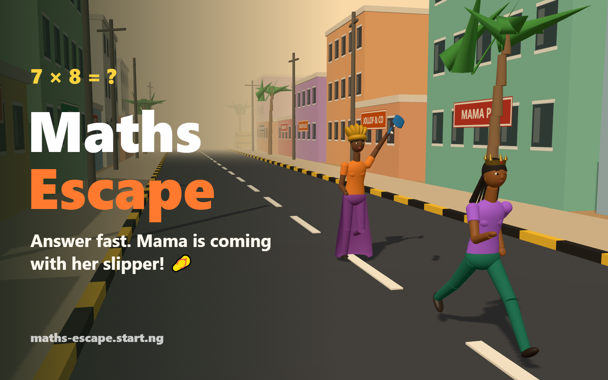

# Maths Escape 🩴

**You failed your maths homework… and Mama is coming with her slipper.**
Answer quick mental-maths questions to outrun her down a Lagos street.

Play it at **https://maths-escape.start.ng**: a three.js game for [start.ng](https://start.ng).



## How to play

- A question appears with **4 answers**. Tap one, or press **1–4**.
- ✅ **Right:** you pull ahead **+3 m** (**+5 m** if you answer within 2 seconds).
- 🔥 **5 in a row:** an extra **+2 m**, and your points multiplier goes up.
- ❌ **Wrong:** you stumble, **−3 m**.
- Mama never stops running, and she gets faster each level. If she reaches you, it's over.
- **Levels** go up every 8 right answers: + and − within 20, then within 100, times tables to 5×, tables to 12× and division, then everything mixed.

Pause with **Esc** / **P**. Start or restart with **Enter**.

## Your start.ng character

The runner **is your start.ng character**. The game asks start.ng who's playing and builds the 3D runner from your `style`: body, top and trouser colours, skin, hair (short, afro, braids, bun, ponytail, dreads, bald), hat (cap, beanie, top hat, crown) and accessory (glasses, earrings, beard, scarf, backpack). Change your look on start.ng and the runner changes with it.

- **Signed in:** your name, face and `@account` show in the corner, and every run is saved to the start.ng leaderboard.
- **Guest:** you play as start.ng's guest look, with a **Sign in** button to save your score.

## Leaderboard

Defined in [`startng.json`](startng.json): **Score** (ranked by this), **Correct answers**, **Best streak**.
Points: 10 per right answer, plus up to 10 for speed, times your streak multiplier (×1 to ×5).

## How it's built

Plain HTML, CSS and JavaScript with [three.js](https://threejs.org) from jsDelivr. There's no build step, as start.ng requires.

| File | What it does |
| --- | --- |
| `src/maths.js` | Question generator: levels, exact division, near-miss wrong answers |
| `src/game.js` | The rules: the gap, Mama's speed, scoring, streaks, levels |
| `src/character.js` | The start.ng character in 3D, with run, stumble, caught and cheer animations |
| `src/mama.js` | Mama (wrapper, buba, gele), her slipper, and throwing it |
| `src/world.js` | The endless Lagos street: buildings, shop signs, palms, poles, a danfo |
| `src/startng.js` | start.ng's connect page: who's playing, sign-in, saving runs, leaderboard |
| `src/audio.js` | Sound effects made with the Web Audio API (no audio files) |
| `src/main.js` | Wires it all together: scene, camera, HUD, input, screens |
| `tools/` | Dev pages: every character style side by side, and the cover generator |

## Run locally

```bash
python -m http.server 5180
```

Then open http://localhost:5180. Outside `*.start.ng` there's no start.ng sign-in, so you play as a guest.

## Tests

The maths and the game rules are pure JavaScript with unit tests (Node 18+):

```bash
npm test
```
